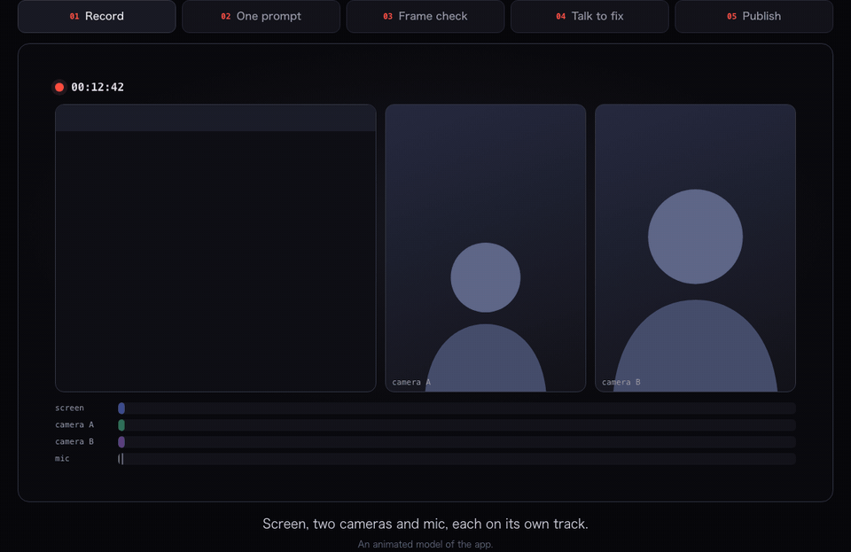

<div align="center">

<picture>
  <source media="(prefers-color-scheme: dark)" srcset=".github/assets/solocut-wordmark-dark.svg">
  
</picture>

**動画編集のための ADE。**<br>
1本撮れば YouTube・TikTok・Shorts の3本に。編集はテンプレどおりに Claude Code や Codex などのエージェントが。<br>
判定モデルがフレーム単位でチェックし、直してほしいところはプレビューに喋るだけ。（ADE = Agentic Development Environment）

[](https://github.com/JapanMarketing-Dev/solocut/stargazers)
[](https://solocut.app/ja/download)
[](LICENSE)
[](https://x.com/ai_agent_dev)

[サイト](https://solocut.app/ja) · [ダウンロード](https://solocut.app/ja/download) · [設計書](docs/) · [X](https://x.com/ai_agent_dev) · [JapanMarketing合同会社](https://www.japan-marketing.co.jp/)

[English](README.md) · **日本語**

<br>



</div>

<br>

## 1人で撮る。画面とカメラを同時に。

画面・カメラ（複数台）・マイクを、それぞれ別のトラックで同時に収録します。テンプレートで、ワイプ、上下分割、カメラのみ、画面のみを区間ごとに切り替えられます。ミラーレスや iPhone で別に撮った素材も、取り込むと音声でフレーム単位に自動同期します（長尺の時計のズレも補正）。カンペ、カウントダウン、話しながら「今のNG」「ここ重要」を残すホットキーもあります。

## 1つのプロンプトで、動画が完成する

10〜20分撮って「**動画を完成させて**」と言うだけ。エージェントが `solocut next` で「今やること」を確認しながら、テンプレートの手順を最後まで進めます（同期、文字起こし、粗カット、画角、字幕、効果音、モザイク、チェック、書き出し、サムネイル、投稿文）。「粗カットだけ」「フィードバックに対応して」「ショートを3本」などのプロンプトも用意済みで、中身は JSON で自由に変えられます。

## 判定モデルが、大事なフレームをすべてチェック

まず機械的なチェック（黒コマ、フリーズ、ラウドネス、書き出しの仕様）。次に**判定モデル**が、カット・字幕・モザイクの前後のフレームを見て、「言葉の途中で切れていないか」「字幕が顔にかかっていないか」「メールアドレスが映っていないか」といった型の決まった問いに確率で答えます。自信があるものは自動で反映し、迷うものだけがあなたに届きます。Ollama で完全ローカルでも、自分の API キーでも動きます。

## 直してほしいところは、書かずに指す

プレビューを再生して、喋る・止める・囲む。端末内で文字起こしし、指摘ごとに「タイムコード、ペン入りのフレーム、あなたの言葉、指した字幕やクリップ」にまとめて、ワンクリックでエージェントへ送ります。

## 1本の素材から3本、3本とも投稿

1回の撮影から、YouTube の本編（16:9）、縦型の TikTok、YouTube Shorts（9:16）の3本を作ります。見どころを選び、顔や操作している箇所を追って縦に組み替え、縦型用の字幕を作り直します。1回承認すれば3本を投稿し、X・Instagram・Threads・Facebook で告知します。承認するまで何も投稿されません。

## そのほか

| | |
|---|---|
| **ぶれないテンプレート**。フォーマット、レイアウト、カット方針、字幕スタイル、チェック、手順に加え、編集方針をプロンプトで書けます。組み込み：技術解説、技術ショート、語り（YouTube）、語り（TikTok）、長尺からショート。[設計](docs/04_templates_and_agents.md) | **型付きで情報量の多い `timeline.json`**。編集ごとに「何を・なぜ・誰が・どれくらいの確信で」、素材のライセンス、チェックの結果まで残るので、どのエージェントでも続きから作業できます。解説シーン（イラスト＋吹き出し＋丸ワイプなど）も型として定義。[設計](docs/15_timeline_schema.md) |
| **参考動画のベンチマーク**。参考にしたい動画（自分の動画や許可を得た動画）を開くと、字幕の出し方、効果音の入れどころ、BGM の音量、カットのテンポを測ってテンプレートにします。[設計](docs/09_benchmark.md) | **画像生成でサムネイル**。Codex のサブスク、OpenAI や Google の API キーで生成。日本語のタイトルは崩れないよう別に組みます。[設計](docs/10_thumbnails.md) |
| **効果音・BGM・イラストがすぐ使える**。自由に使える素材を、選んだときにだけダウンロード。クレジット表記も点数の上限も自動で管理します。[設計](docs/16_asset_library.md) | **過去の動画をいつでも参考に**。完成した動画と timeline.json を検索できる形で保存。「先月のあの回みたいに」で通じます。[設計](docs/17_archive.md) |
| **モザイクも自動**。メール、通知、APIキー、映り込んだ他人の顔やナンバープレートを検出・追跡して隠します。[設計](docs/05_decision_model.md) | **設定はすべて JSON**。`~/.solocut/settings.json` と公開スキーマ。エージェントに設定を頼めます。[設計](docs/11_settings.md) |
| **初期設定でプライベート**。動画と音声は端末から出ません。文字起こしは whisper.cpp で端末内。 | **無料・オープンソース**。MIT ライセンス。アカウント登録、透かし、サブスクなし。macOS・Windows・Linux。 |

## 対応エージェント

Claude Code · Codex · Gemini CLI · OpenCode · Cursor CLI · GitHub Copilot CLI · 独自のコマンド。アプリの中の本物のターミナルで動き、タブで切り替えられます。使用量の上限に達したら、次のエージェントが引き継ぎメモから続けます。

## ダウンロード

**[solocut.app/ja/download](https://solocut.app/ja/download)** から、macOS・Windows・Linux 版を入手できます。インストール後は自動で更新されます。すべてのリリースに署名し、チェックサムを公開しています。

## 設計書

[docs/](docs/) に全体の設計があります（01 コンセプトと要件 〜 17 アーカイブ、実装の取り決めは [docs/dev/CONTRACTS.md](docs/dev/CONTRACTS.md)）。

## 開発

```bash
pnpm install
pnpm dev          # デスクトップアプリを起動
pnpm test         # 単体・結合テスト（ffmpeg が必要）
pnpm typecheck
```

## ライセンス

[MIT](LICENSE) © 2026 [JapanMarketing合同会社](https://www.japan-marketing.co.jp/)。FFmpeg や whisper.cpp などの外部ツールは、必要なときにダウンロードされ、それぞれのライセンスに従います。

最新情報は [X @ai_agent_dev](https://x.com/ai_agent_dev) で。
