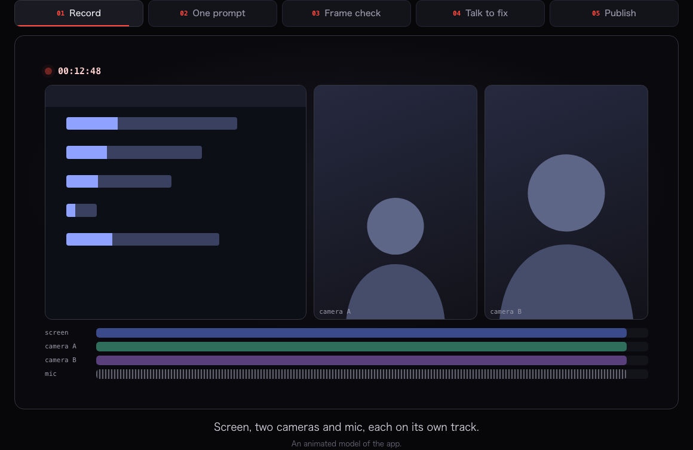
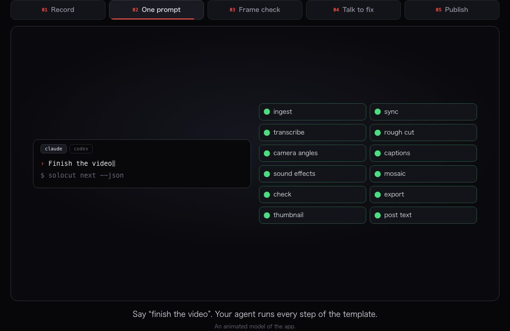
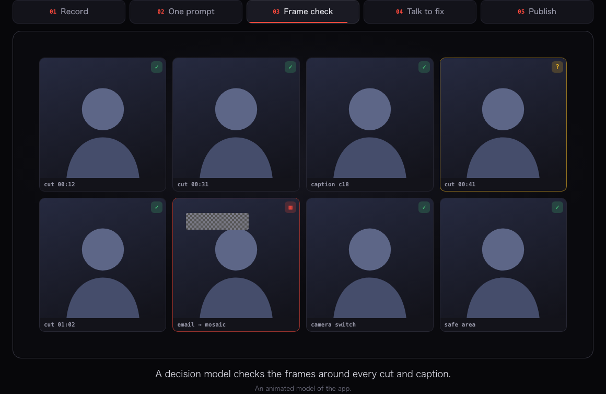
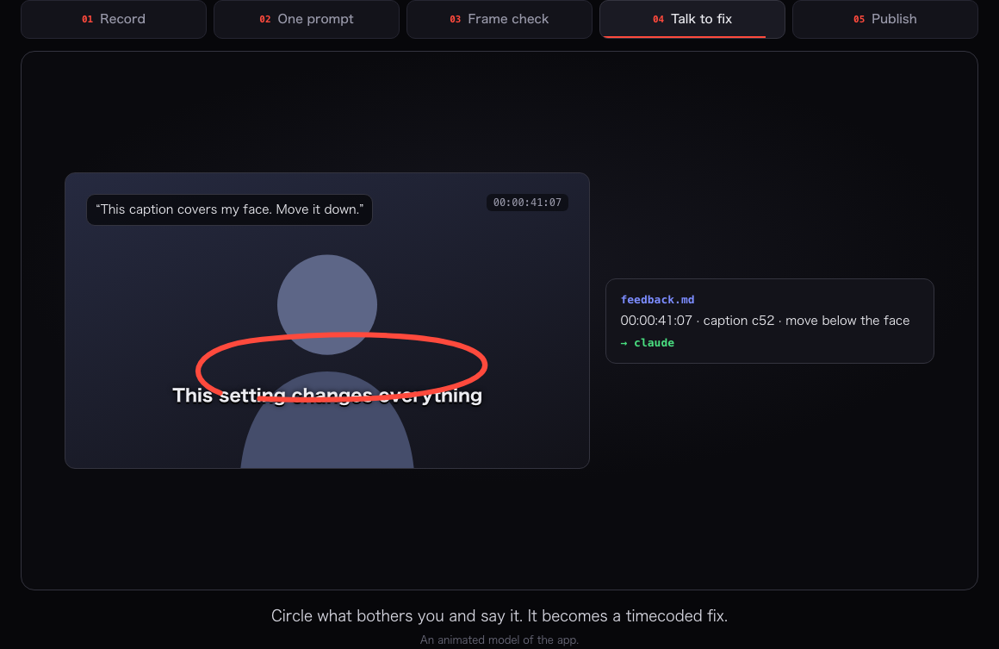
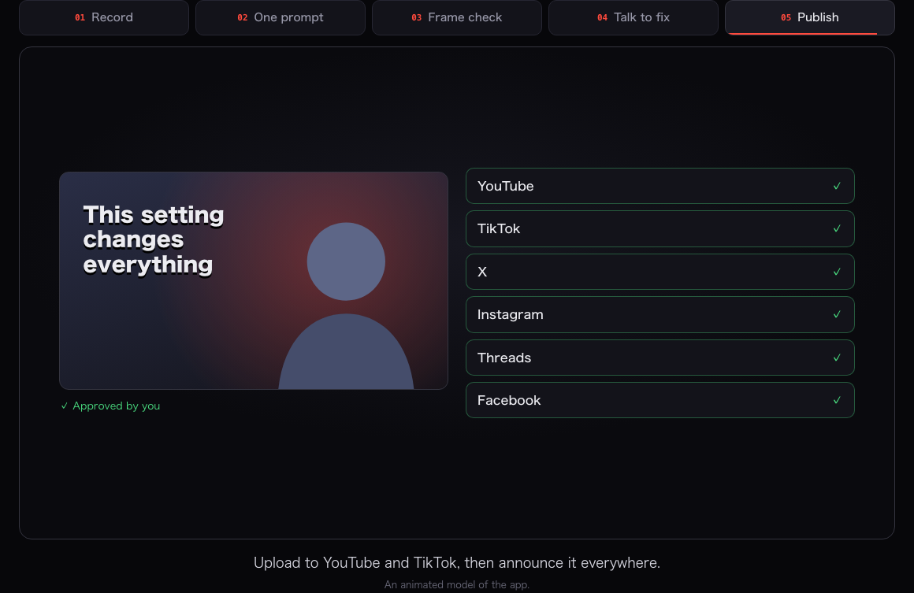

<!--
  docs/images/hero.gif and docs/images/scenes/*.png are rendered from the landing page animation (site/js/app.js, solocut.app).
-->

<div align="center">

<picture>
  <source media="(prefers-color-scheme: dark)" srcset=".github/assets/solocut-wordmark-dark.svg">
  
</picture>

**The ADE for video editing.**<br>
Shoot once; get a YouTube video, a TikTok and a YouTube Short. Claude Code, Codex or any terminal agent edits by template,<br>
a decision model checks every frame, and you fix things by talking over the preview. (ADE = Agentic Development Environment.)

[](https://github.com/JapanMarketing-Dev/solocut/stargazers)
[](https://solocut.app/download)
[](LICENSE)
[](https://x.com/ai_agent_dev)

[Website](https://solocut.app) · [Download](https://solocut.app/download) · [Design docs](docs/) · [X](https://x.com/ai_agent_dev) · [JapanMarketing](https://www.japan-marketing.co.jp/)

**English** · [日本語](README.ja.md)

<br>


</div>

<br>

## Shoot alone. Screen and cameras at once.

Record your screen, one or more cameras and your mic together, each on its own track, so the template can switch between picture-in-picture, split screen, camera only or screen only at any point. Shot something on a mirrorless camera or an iPhone too? Import it and Solocut syncs it to the frame by audio, with drift correction for long takes. Teleprompter, countdown and hotkeys to mark “bad take” or “important” while you talk.



## One prompt to a finished video

Shoot 10 to 20 minutes and say **“Finish the video”**. Your agent follows the template step by step (`solocut next` tells it what to do now): sync, transcribe, rough cut, camera angles, captions, sound effects, mosaic, checks, export, thumbnail and the post text. Ready-made prompts cover the rest (rough cut only, fix my feedback, make three Shorts, write the post), and every prompt is yours to edit in JSON.



## A decision model checks every frame that matters

Machine checks run first: black frames, freezes, loudness and the export spec. Then a **decision model** looks at the frames around every cut, caption and mosaic and answers typed questions with a probability: is this cut mid-word, does this caption cover a face, is an email visible on screen? Confident answers are applied; only the uncertain ones come to you. Run it locally with Ollama or with your own API key.



## Don’t type the fix. Point at it.

Play the preview, talk, pause and circle. Solocut transcribes on your machine and turns each remark into a timecode, a frame with your pen, your words and the exact caption or clip you meant. One click sends it to your agent.



## One take, three videos, three posts

From one recording Solocut makes the YouTube video (16:9), a vertical TikTok cut and a YouTube Short (9:16): highlights picked, re-framed around your face or your cursor, captions rebuilt for vertical. Approve once and all three are posted, then announced on X, Instagram, Threads and Facebook. Nothing goes out until you check and approve it.



## More

| | |
|---|---|
| **Templates that hold the line.** Format, layout, cut policy, caption style, checks and the pipeline, with the editing rules written as prompts. Built in: tech tutorial, tech short, talk for YouTube, talk for TikTok, Shorts from a long video. [Design](docs/04_templates_and_agents.md) | **A typed, information-rich `timeline.json`.** Every edit records what, why, who decided and how sure, plus licenses and check results, so any agent can pick up the project cold. Scene patterns (illustration + speech bubbles + round wipe…) are typed too. [Design](docs/15_timeline_schema.md) |
| **Benchmark a reference video.** Open a video you are allowed to study and Solocut measures how captions appear, where sound effects land, how loud the music sits and how fast the cuts come, then turns it into a template. [Design](docs/09_benchmark.md) | **Thumbnails with image generation.** Through your Codex subscription or an OpenAI / Google API key. Japanese titles are typeset separately so they never break. [Design](docs/10_thumbnails.md) |
| **Sound effects, music and illustrations on tap.** Free-to-use assets download the moment you or your agent picks them, with credits written for you and license limits counted. [Design](docs/16_asset_library.md) | **Your past videos, at hand.** Every finished video and its timeline stay searchable, so you can say “make it like last month’s”. [Design](docs/17_archive.md) |
| **Mosaic, automatically.** Emails, notifications, API keys, bystanders’ faces and plates are detected, tracked and hidden. [Design](docs/05_decision_model.md) | **Every setting is JSON.** `~/.solocut/settings.json` with a public schema, so your agent can configure Solocut for you. [Design](docs/11_settings.md) |
| **Private by default.** Video and audio stay on your machine. Transcription runs on-device with whisper.cpp. | **Free and open source.** MIT. No account, no watermark, no subscription. macOS, Windows and Linux. |

## Supported agents

Claude Code · Codex · Gemini CLI · OpenCode · Cursor CLI · GitHub Copilot CLI · or any command you register. Agents run in real terminals inside Solocut; switch between them in tabs, and when one hits its usage limit the next one picks up from the handoff note.

## Download

Get Solocut for macOS, Windows and Linux at **[solocut.app/download](https://solocut.app/download)**. It updates itself; every release is signed and its checksums are published.

## Documentation

The full design (Japanese) lives in [docs/](docs/):

| | |
|---|---|
| [01 Concept and requirements](docs/01_concept.md) | [10 Thumbnails](docs/10_thumbnails.md) |
| [02 Architecture](docs/02_architecture.md) | [11 Settings](docs/11_settings.md) |
| [03 Recording and sync](docs/03_recording_and_sync.md) | [12 Premiere, CapCut, Resolve](docs/12_competitors.md) |
| [04 Templates and agents](docs/04_templates_and_agents.md) | [13 Prompts and autopilot](docs/13_prompts_and_autopilot.md) |
| [05 Decision model, checks, mosaic](docs/05_decision_model.md) | [14 Publishing](docs/14_publishing.md) |
| [06 Libraries and export presets](docs/06_libraries.md) | [15 timeline.json](docs/15_timeline_schema.md) |
| [07 Distribution and updates](docs/07_distribution.md) | [16 Asset library](docs/16_asset_library.md) |
| [08 Quality and risks](docs/08_quality.md) | [17 Archive](docs/17_archive.md) |
| [09 Benchmark](docs/09_benchmark.md) | [Implementation contracts](docs/dev/CONTRACTS.md) |

## Development

```bash
pnpm install
pnpm dev          # run the desktop app
pnpm test         # unit and integration tests (needs ffmpeg on PATH)
pnpm typecheck
```

Monorepo: `packages/core` (timeline types, edit ops, render compiler), `media` (ffmpeg, sync, checks), `captions`, `toolchain`, `settings`, `templates`, `agents`, `archive`, `decide`, `cli` (`solocut`), and `apps/desktop` (Electron).

## License and credits

[MIT](LICENSE) © 2026 [JapanMarketing LLC](https://www.japan-marketing.co.jp/). Third-party tools (FFmpeg, whisper.cpp and others) are downloaded on demand under their own licenses.

Follow updates on [X @ai_agent_dev](https://x.com/ai_agent_dev).
